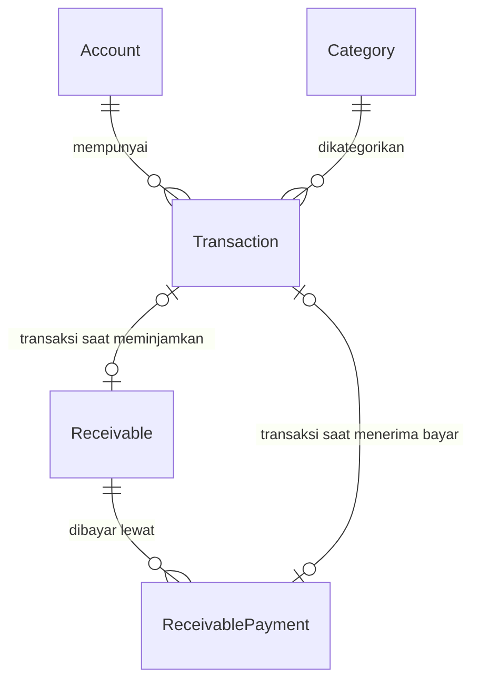

# Keuangan Pribadi

Pencatat keuangan pribadi berbasis web. Mencatat pemasukan dan pengeluaran,
mengelola akun dan kategori, lalu melihat ringkasan bulanan beserta rincian
per kategori.

Dibangun dengan Next.js 15 (App Router), TypeScript, Prisma, SQLite, dan
Tailwind CSS v4. Berjalan lokal di satu mesin, tanpa login, tanpa layanan
eksternal. Seluruh data tersimpan di file `prisma/dev.db`.

## Prasyarat

- Node.js 20 atau lebih baru (diuji di Node 22)
- npm 10 atau lebih baru

## Menjalankan

```bash
npm install          # sekaligus menjalankan `prisma generate`
npm run db:migrate   # membuat tabel di prisma/dev.db
npm run db:seed      # mengisi kategori bawaan + akun "Dompet Tunai"
npm run dev          # http://localhost:3000
```

## Perintah npm

| Perintah | Kegunaan |
| --- | --- |
| `npm run dev` | Server pengembangan di `http://localhost:3000` (hanya localhost) |
| `npm run build` | Build produksi |
| `npm start` | Menjalankan hasil build produksi |
| `npm run lint` | ESLint |
| `npm test` | Menjalankan seluruh tes (Vitest) |
| `npm run test:watch` | Mode watch selama pengembangan |
| `npm run db:migrate` | Membuat dan menerapkan migrasi (`prisma migrate dev`) |
| `npm run db:push` | Mendorong skema langsung tanpa berkas migrasi |
| `npm run db:seed` | Menjalankan `prisma/seed.ts` (aman diulang) |
| `npm run db:reset` | Menghapus database, menerapkan migrasi, lalu seed |
| `npm run db:backup` | Menyalin database ke `prisma/backups/` (aman saat server hidup) |
| `npm run db:studio` | Prisma Studio untuk melihat dan mengubah data |

Server pengembangan dan produksi sengaja hanya mendengarkan di `127.0.0.1`.
Aplikasi ini tidak punya autentikasi, jadi membukanya ke jaringan LAN berarti
siapa pun bisa menghapus seluruh data keuangan.

## Model data

Lima model: `Account`, `Category`, `Transaction`, `Receivable`,
`ReceivablePayment`.



Foreign key memakai `onDelete: Restrict`, jadi akun atau kategori yang masih
dipakai transaksi tidak bisa dihapus. Hapus memang diblokir; arsipkan
sebagai gantinya agar riwayat tetap utuh.

## Total kekayaan

Angka utama di paling atas dashboard:

```
Total kekayaan = cash di seluruh akun + piutang yang belum lunas
```

Tidak ada tabel database tambahan untuk ini. Nilainya dirakit di
[`src/server/queries/wealth.ts`](src/server/queries/wealth.ts) dari
[`getAccountBalances()`](src/server/queries/finance.ts) dan
`getReceivableSummary()`. Rumus yang murni ada di
[`src/lib/wealth.ts`](src/lib/wealth.ts) supaya bisa diuji terpisah dari
pembacaan database.

**Akun terarsip tetap dihitung.** Arsip hanya berarti akun disembunyikan dari
pilihan form, bukan berarti uangnya hilang. Mengabaikannya akan membuat total
kekayaan kurang dari kenyataan, dan itu berbahaya untuk satu-satunya angka
yang dipakai mengukur progres tabungan. Karena itu `getAccountBalances()`
menerima opsi `includeArchived`, dan total kekayaan selalu meminta `true`.

Agar angkanya bisa diaudit, daftar "Saldo akun" di dashboard juga menampilkan
akun terarsip dengan badge "Diarsipkan", diwarnai lebih redup. Kalau total
menyebut angka tertentu, kamu bisa cari akun mana saja yang menyusunnya.

**Pengeluaran riil.** Meminjamkan uang ke orang lain tercatat sebagai
pengeluaran, padahal itu bukan pengeluaran, hanya berubah bentuk uang. Karena
itu kartu Pengeluaran menampilkan nominal setelah dikurangi bagian piutang, dan
ada catatan pengurang di bawahnya kalau ada piutang aktif di bulan itu.

## Piutang

Fitur untuk mencatat uang yang dipinjamkan ke orang lain.

**Cara hitungnya.** Saat kamu mencatat piutang, sistem otomatis membuat satu
transaksi **EXPENSE** sebesar nominal di akun yang dipilih, karena uangnya
benar-benar keluar. Saat pembayaran diterima, tercatat sebagai transaksi
**INCOME** di akun tujuan. Dua-duanya terhubung ke catatannya lewat relasi.

Konsekuensinya: saldo kas kamu selalu akurat, dan sisa piutang bisa
dihitung ulang dari transaksi yang sama. `remaining` sengaja tidak disimpan
sebagai kolom, melainkan selalu dihitung dari `amount` dikurangi jumlah
pembayaran, sehingga tidak ada angka yang bisa melenceng dari pembayarannya.

**Antarmuka.** Halaman `/piutang` menampilkan total outstanding, yang lewat
jatuh tempo, dan yang jatuh tempo dalam 30 hari ke depan. Tiap baris punya
progress bar pembayaran dan label status: Terlambat, Belum lunas, Lunas, atau
Dibatalkan. Halaman detail `/piutang/[id]` memuat form pembayaran, riwayat
pembayaran, dan formulir ubah.

**Yang dijaga server.** Aturan berikut ditegakkan di Server Action, bukan
hanya di antarmuka:

| Aturan | Kenapa |
| --- | --- |
| Pembayaran tidak boleh melebihi sisa | Sisa tidak boleh jadi negatif |
| Nominal pokok tidak boleh turun di bawah total yang sudah dibayar | Menghindari sisa negatif saat diubah |
| Tanggal bayar tidak boleh sebelum tanggal pinjam | Mencegah tanggal masuk yang tidak masuk akal |
| Jatuh tempo tidak boleh sebelum tanggal pinjam | Sama |
| Piutang lunas atau dibatalkan tidak menerima pembayaran | Mencegah pemasukan pada piutang mati |
| Piutang yang sudah punya pembayaran tidak bisa dihapus | Melindungi riwayat rekonsiliasi |
| Kategori harus sesuai jenis (EXPENSE saat meminjam, INCOME saat menerima) | Mencegah pembukuan terbalik |

Aturan numeriknya dipisah ke
[`src/lib/receivable-rules.ts`](src/lib/receivable-rules.ts) supaya bisa diuji
tanpa menjalankan Server Action.

## Ekspor Laporan Kas

Fitur untuk mengunduh rekapitulasi mutasi kas per periode bulan yang mendukung
dua format sekaligus:

1. **Excel (`.xls`)**: Format spreadsheet resmi yang langsung menampilkan tabel
   bergaris (*gridlines* aktif), header berwarna hijau pinus & emas, angka
   berformat rupiah dengan pemisah ribuan otomatis, serta baris total
   rekapitulasi (Total Penerimaan, Total Pengeluaran, Surplus/Defisit) di
   bagian bawah. Cocok diserahkan langsung ke pimpinan atau akuntan.
2. **CSV (`.csv`)**: Format data teks mentah ber-BOM UTF-8 (``) dan
   terproteksi dari *formula injection* (DDE), cocok untuk impor ke software
   akuntansi atau pemrosesan database.

Tersedia tombol ekspor di dashboard dan pemilih format **Excel / CSV** di header
halaman `/transaksi` yang otomatis menyesuaikan filter periode aktif (bulan,
jenis, kategori, rekening, kata kunci).

## Tiga keputusan yang perlu diketahui

### 1. Nilai enum disimpan sebagai `String`

Prisma **tidak** mendukung `enum` pada SQLite. Field `Account.type`,
`Category.kind`, dan `Transaction.kind` karena itu disimpan sebagai teks.
Validasi berlangsung dua lapis: union type di `src/lib/types.ts` dan zod di
`src/lib/validations/`.

### 2. Tanggal disimpan sebagai UTC midnight

`Transaction.occurredAt` menyimpan UTC midnight dari tanggal lokal
Asia/Jakarta. Input `2026-10-01` menjadi `2026-10-01T00:00:00.000Z`.

Semua agregasi bulanan melewati `monthToRange()` di `src/lib/date.ts` yang
menghasilkan rentang `[awal, akhir)` dalam batas UTC. Karena SQLite
menyimpan `DATETIME` sebagai teks dan membandingkannya secara leksikografis,
normalisasi ke UTC membuat batas bulan selalu konsisten. Tanpa ini transaksi
dapat meleset ke bulan tetangga.

### 3. Nominal memakai `Int`, bukan `BigInt`

`amount` disimpan sebagai rupiah penuh tanpa sen dan **selalu positif**; arah
uang ditentukan oleh `kind`. Batas `Int` 32-bit adalah
`Rp 2.147.483.647` per transaksi.

`BigInt` sengaja dihindari karena nilainya tidak bisa di-`JSON.stringify`,
sehingga memicu error "Props must be serializable" saat melewati batas
Server Component ke Client Component.

## Tampilan

Antarmuka mendukung mode terang dan gelap. Pilihan tema disimpan di
`localStorage`, dan dibaca ulang oleh skrip inline di
[`src/app/layout.tsx`](src/app/layout.tsx) sebelum halaman digambar sehingga
tidak ada kedipan putih saat reload.

### Token warna semantik

Komponen memakai nama warna peran, bukan warna mentah:

| Token | Kegunaan |
| --- | --- |
| `bg-surface`, `bg-surface-muted` | Permukaan kartu dan area cekap |
| `text-foreground`, `text-muted-foreground` | Teks utama dan sekunder |
| `border-border` | Garis pemisah |
| `bg-primary`, `text-primary-foreground` | Aksi utama dan navigasi aktif |
| `text-income`, `text-expense` | Warna pemasukan dan pengeluaran |

Nilai token ini didefinisikan sebagai variabel CSS di
[`src/app/globals.css`](src/app/globals.css) pada blok `:root` dan `.dark`.
Artinya mode gelap cukup dari satu blok token, tanpa menuliskan varian `dark:`
di setiap komponen.

### Ikon

Ikon garis disimpan sebagai komponen React di
[`src/components/Icons.tsx`](src/components/Icons.tsx), bukan paket ikon
eksternal, supaya tidak ada request jaringan tambahan.

### Struktur direktori

```text
src/
├── app/
│   ├── page.tsx                  # Dashboard
│   ├── akun/                     # CRUD akun
│   ├── kategori/                 # CRUD kategori
│   ├── piutang/                  # daftar, baru, dan detail
│   └── transaksi/                # daftar, baru, dan ubah
├── components/
│   ├── Icons.tsx                 # set ikon garis
│   ├── ThemeToggle.tsx           # pengalih terang/gelap
│   ├── WealthCard.tsx            # kartu total kekayaan
│   ├── layout/                   # AppShell, SidebarNav, NavLinks, MobileNav
│   ├── ui/                       # primitif: Card, Button, Form, dialog
│   ├── accounts/ categories/ transactions/ receivables/
├── lib/
│   ├── db.ts                     # Prisma singleton
│   ├── money.ts                  # format & parse rupiah
│   ├── date.ts                   # bulan, UTC midnight, rentang
│   ├── types.ts                  # konstanta & union type domain
│   ├── receivable-rules.ts       # aturan bisnis piutang (murni)
│   ├── wealth.ts                 # rumus total kekayaan (murni)
│   └── validations/              # skema zod
└── server/
    ├── actions/                  # mutasi ('use server')
    └── queries/                  # agregasi baca: finance, receivables, wealth
```

## Pola mutasi

Semua tulisan lewat Server Action dengan urutan yang sama:

1. `zod.safeParse` isian `FormData`
2. cek integritas di database (akun aktif, kategori cocok jenis)
3. tulis, lalu `revalidateFinancePages()` untuk invalidate keempat path
4. `redirect()` ke daftar setelah transaksi tersimpan

Form memakai `useActionState`, jadi pesan kesalahan tampil inline di bawah
field yang bermasalah tanpa memuat ulang halaman.

## Pengujian

Logika uang, tanggal, dan aturan piutang sengaja dibuat murni (tanpa akses
database) supaya bisa diuji langsung. Tes berjalan dengan Vitest:

```bash
npm test
```

Empat berkas tes saat ini menutupi
[`src/lib/money.ts`](src/lib/money.ts), [`src/lib/date.ts`](src/lib/date.ts),
[`src/lib/receivable-rules.ts`](src/lib/receivable-rules.ts), dan skema validasi
di [`src/lib/validations/`](src/lib/validations/).

## Catatan operasional

- Halaman yang membaca database menandai `export const dynamic =
  "force-dynamic"` agar data tidak ikut ter-baked ke HTML saat build.
- SQLite menyimpan data di `prisma/dev.db`, file itu sudah masuk `.gitignore`.
  Untuk membuat cadangan, jalankan `npm run db:backup` — skripnya memakai
  `VACUUM INTO` sehingga salinannya tetap konsisten walau server sedang aktif.
  Folder `prisma/backups/` juga sudah diabaikan git.
- SQLite tidak cocok untuk banyak penulis secara bersamaan, cukup untuk satu
  pengguna.

## Untuk membantu pengembangan

[`AGENTS.md`](AGENTS.md) berisi aturan dan jebakan yang perlu diketahui sebelum
mengubah kode di repo ini: aturan nominal dan tanggal, pola Server Action, sistem
token warna, serta daftar kesalahan yang pernah terjadi. Bacanya sebelum mulai
ngoprek.

## Peta jalan v2

- Target tabungan dengan progres, misalnya dana nikah, di bawah total kekayaan
- Tren total kekayaan dari bulan ke bulan
- Transaksi berulang (gaji, tagihan bulanan) yang tercatat otomatis
- Transfer antar akun sebagai dua transaksi berpasangan
- Pengingat jatuh tempo piutang
- Impor CSV dari mutasi bank

Detail spesifikasi dan perencanaan fitur Personal Finance Planner selengkapnya tersedia di [`docs/ROADMAP_PLANNER.md`](docs/ROADMAP_PLANNER.md).
